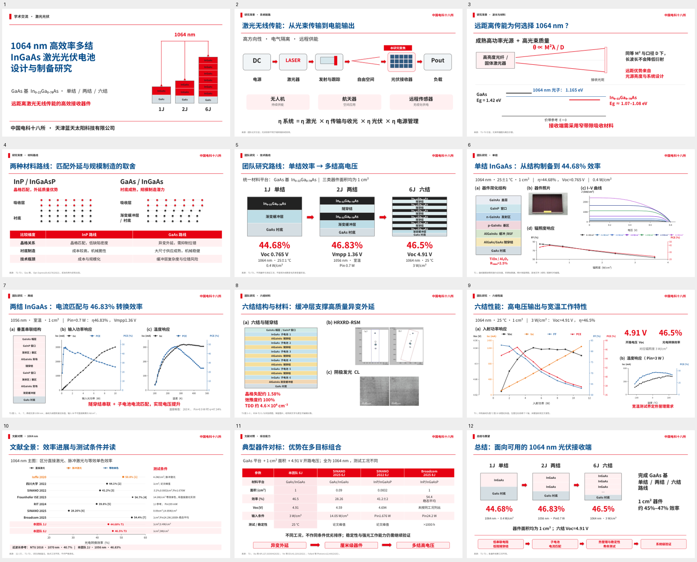

# 1064 nm高效率多结InGaAs激光光伏电池设计与制备研究

12页中文学术交流演示文稿，内容包括激光无线传能背景、材料路线选择、团队单结/两结/六结器件及文献对比。

## 单页导出：两种材料路线（红白配色）

[SVG矢量图](https://github.com/ynyzzygm-cpu/ppt/raw/refs/heads/main/single_slide/1064nm_material_routes_redwhite.svg) · [PDF矢量图](https://github.com/ynyzzygm-cpu/ppt/raw/refs/heads/main/single_slide/1064nm_material_routes_redwhite.pdf) · [PNG](https://github.com/ynyzzygm-cpu/ppt/raw/refs/heads/main/single_slide/1064nm_material_routes_redwhite.png) · [JPG](https://github.com/ynyzzygm-cpu/ppt/raw/refs/heads/main/single_slide/1064nm_material_routes_redwhite.jpg) · [单页可编辑PPT](https://github.com/ynyzzygm-cpu/ppt/raw/refs/heads/main/single_slide/1064nm_material_routes_redwhite.pptx)

[全部格式ZIP下载](https://github.com/ynyzzygm-cpu/ppt/raw/refs/heads/main/single_slide/1064nm_material_routes_redwhite_all_formats.zip)。SVG/PDF为纯矢量，PNG/JPG为3840×2160；PPT的节点、连线与比较表均可编辑。

## 单页导出：1064 nm波长选择（红白配色）

- [下载SVG纯矢量图](https://github.com/ynyzzygm-cpu/ppt/raw/refs/heads/main/single_slide/1064nm_wavelength_redwhite.svg)
- [下载PNG高清图片（3840×2160）](https://github.com/ynyzzygm-cpu/ppt/raw/refs/heads/main/single_slide/1064nm_wavelength_redwhite.png)
- [下载全部格式ZIP（SVG、PDF、PNG、JPG、可编辑PPTX）](https://github.com/ynyzzygm-cpu/ppt/raw/refs/heads/main/single_slide/1064nm_wavelength_redwhite_all_formats.zip)

SVG/PDF为纯矢量，不含嵌入位图；仅处理用户选定页面，不替换整套演示稿。

## 新版：红白配色可编辑演示稿

- [下载可编辑PPT（12页，红白配色）](https://github.com/ynyzzygm-cpu/ppt/raw/refs/heads/main/1064nm_presentation_editable_redwhite.pptx)
- [下载新版PDF](https://github.com/ynyzzygm-cpu/ppt/raw/refs/heads/main/1064nm_presentation_editable_redwhite.pdf)
- [编辑说明](EDITABLE_GUIDE.md) / [讲稿及参考文献](speaker_notes_editable.md)
- [曲线近似数据CSV](editable_curve_data.csv) / [完整图表数据JSON](editable_chart_data.json)

标题、正文、结构图、表格为原生可编辑对象；14个曲线/数据图表均内嵌可编辑工作簿。实验照片、RSM和CL保留图片。曲线恢复值为论文读图近似值，非原始测量数据。六结四Y轴采用4个透明图表叠加，编辑方法见说明。

## 旧版：图片式演示稿下载

- [PowerPoint演示文稿（约16 MB）](https://github.com/ynyzzygm-cpu/ppt/raw/refs/heads/main/1064nm_presentation.pptx)
- [PDF版本（约3 MB）](https://github.com/ynyzzygm-cpu/ppt/raw/refs/heads/main/1064nm_presentation.pdf)
- [中文讲稿与文献出处](speaker_notes.md)

如果浏览器打开文件预览页，请点击页面上的下载按钮。私有仓库需先登录有访问权限的GitHub账号。

## 旧版内容说明

- 单结、两结分别采用结构—实验结果大组图；六结分为材料结构与光电/温度特性两页。
- 六结四条曲线共用横轴，左右各两个独立Y轴，轴线与曲线同色。
- 两结论文实际测试光源为1056 nm，文中已明确区分。
- 合并曲线来自原论文读图，点位为近似值；关键指标按论文正文标注。
- 页面采用整页图片，文字及曲线不是可逐项编辑的原生对象；12页讲者备注已嵌入PPT。
- 文献对比保留不同波长、面积和测试方式的条件差异，不宣称本团队效率为全球最高。

文件校验值见[SHA256SUMS.txt](SHA256SUMS.txt)。

## 新增：1064 nm激光光伏电池文献数据汇总

按上传参考表的11列核对33篇不同论文，形成69条器件/测试条件记录，包含吸收层基区/发射区组分、衬底、结数等。实测/等效/模拟、波长和面积口径分别注明。

- [下载完整Excel](https://github.com/ynyzzygm-cpu/ppt/raw/refs/heads/main/literature_summary/1064nm_literature_summary.xlsx)
- [下载PDF汇总表](https://github.com/ynyzzygm-cpu/ppt/raw/refs/heads/main/literature_summary/1064nm_literature_summary.pdf)
- [完整表格、文献目录与核对说明](literature_summary/README.md)

## 最新：19页红白学术图片版PPT

按新上传PPT重新设计全部页面，重点重绘材料路线与单结/两结/六结大组图。按最新要求输出图片版：每页2880×1620，PPT约12.34 MB。

- [下载高清图片版PPT](https://github.com/ynyzzygm-cpu/ppt/raw/refs/heads/main/academic_redesign/1064nm_InGaAs_redwhite_academic_image.pptx)
- [下载PDF](https://github.com/ynyzzygm-cpu/ppt/raw/refs/heads/main/academic_redesign/1064nm_InGaAs_redwhite_academic.pdf)
- [下载19页高清图片包](https://github.com/ynyzzygm-cpu/ppt/raw/refs/heads/main/academic_redesign/1064nm_slide_images.zip)
- [预览及修改说明](academic_redesign/README.md)

## 最新：最初12页版补充背景与现状（14页，红白图片版）

以用户重新上传的最初版为底稿，补入典型应用场景与国内外研究现状；原团队五页的主要内容、实验图与组图布局保留，仅统一配色。每页2880×1620，PPT约26.5 MB，原12页讲者备注保留。

- [下载14页图片版PPT](https://github.com/ynyzzygm-cpu/ppt/raw/refs/heads/main/original_plus_background/1064nm_original_plus_background_redwhite.pptx)
- [下载PDF](https://github.com/ynyzzygm-cpu/ppt/raw/refs/heads/main/original_plus_background/1064nm_original_plus_background_redwhite.pdf)
- [下载14页高清图片包](https://github.com/ynyzzygm-cpu/ppt/raw/refs/heads/main/original_plus_background/1064nm_original_plus_background_images.zip)
- [预览与修改说明](original_plus_background/README.md)

## 第8页单页修订

按参考截图重写8层外延组分，换入器件/栅线、I–V、EQE、辐照响应和反射率5幅原图组成组图，其余文字段落保留。仅输出这一页，图片版PPT约2.2 MB。

- [下载第8页单页PPT](https://github.com/ynyzzygm-cpu/ppt/raw/refs/heads/main/single_slide/page08_revised/1064nm_page08_revised.pptx)
- [查看单页预览](single_slide/page08_revised/1064nm_page08_revised.png)

## 最新三页修订：GaAs/InP文献对照与9结总结

按指定文献更新的GaAs/InP效率—开路电压双纵轴图；2025—2026年器件比较与9结总结两页保留。第一页原生可编辑，详细来源及测试口径已嵌入讲者备注。

- [下载三页PPT](https://github.com/ynyzzygm-cpu/ppt/raw/refs/heads/main/three_slide_update/1064nm_three_slides_updated.pptx)
- [PDF预览](https://github.com/ynyzzygm-cpu/ppt/raw/refs/heads/main/three_slide_update/1064nm_three_slides_updated.pdf)
- [PNG图片包](https://github.com/ynyzzygm-cpu/ppt/raw/refs/heads/main/three_slide_update/1064nm_three_slide_images.zip)
- [三页预览与说明](three_slide_update/README.md)

## 指定文献图：效率与开路电压（原生PPT与矢量导出）

GaAs与InP各6个器件点，效率旁含结数、面积与输入功率；横轴只列团队和年份。C29归入InP；GaAs含本团队1J/2J/6J。

- [修改后的单页PPT](https://github.com/ynyzzygm-cpu/ppt/raw/refs/heads/main/selected_studies_voc/1064nm_selected_studies_slide.pptx)
- [两幅图的PNG、SVG、PDF、PPT与数据](selected_studies_voc/README.md)
- [下载全部格式ZIP](https://github.com/ynyzzygm-cpu/ppt/raw/refs/heads/main/selected_studies_voc/1064nm_comparison_all_formats.zip)
