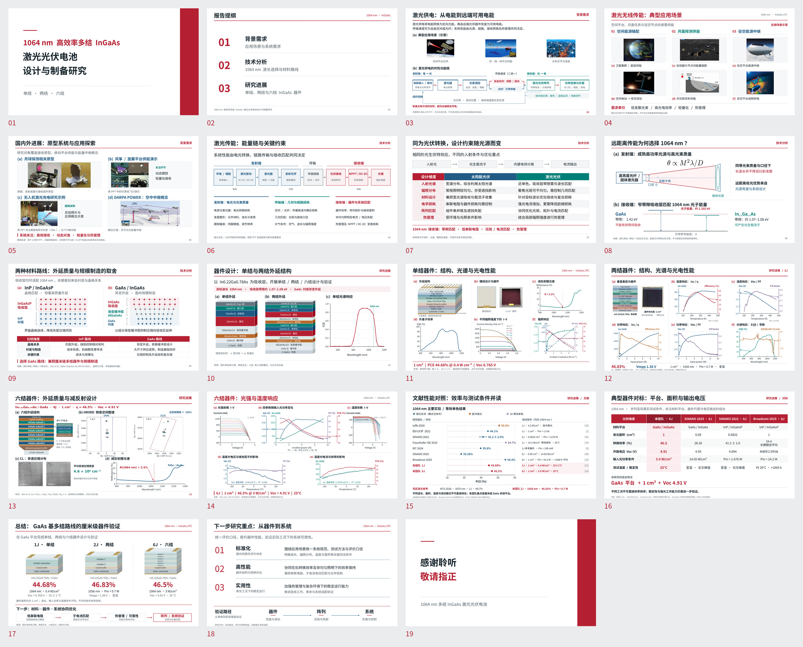

# 1064 nm高效率多结InGaAs激光光伏电池 · 红白学术图片版

按最新要求交付**高清图片版PPT**：19页、16:9，每页2880×1620像素。PPT约12.34 MB，PDF约2.8 MB；已通过实际Office渲染与页序/嵌入图像校验。

- [下载图片版PPT](https://github.com/ynyzzygm-cpu/ppt/raw/refs/heads/main/academic_redesign/1064nm_InGaAs_redwhite_academic_image.pptx)
- [下载PDF](https://github.com/ynyzzygm-cpu/ppt/raw/refs/heads/main/academic_redesign/1064nm_InGaAs_redwhite_academic.pdf)
- [下载全部19页高清PNG](https://github.com/ynyzzygm-cpu/ppt/raw/refs/heads/main/academic_redesign/1064nm_slide_images.zip)
- [查看整稿预览](overview.jpg)
- [文件检查记录](image_deck_validation.json)

## 页面设计

全稿使用红白主色，配深蓝、深青、紫色及棕橙色；统一页眉、分图编号、图注和留白。封面与结束页采用相互呼应的留白和深红色域。精简正文，重点展示结构、系统图、组图和数据对比。

- 第9页：重画两种材料路线、晶格关系及比较表。
- 第10页：单结/两结外延结构与光谱响应大组图。
- 第11页：单结六分图；立体外延结构、反射率曲线、EQE、英文I–V坐标与四量辐照响应统一设计；每条辐照响应曲线有箭头指向其同色Y轴。
- 第12页：两结器件与五张曲线组成大组图，五组双Y轴使用深色配色及对应轴箭头。
- 第13页：六结材料结构、RSM、CL及反射率组成大组图；保留真实测量图像。
- 第14页：六结四幅功率小图合并为共享X轴的四量图，左右各两个独立Y轴；曲线对应轴箭头齐全；下方两幅温度图同步优化配色及线型。
- 其它页面：重新设计背景、系统链、波长与材料分析、文献对比、总结与展望。第5页按用户明确选择保留原始照片，仅调整排版和图注。

用户描述的“单结六图页、两结五曲线页、六结四小图页”在上传文件中的实际页码分别为11、12、14，均已按内容落实。

## 科研数据说明

曲线依据上传论文/原PPT图像重绘，部分点位为读图近似值，**不等同于原始测量数据**；关键指标按论文正文核对。

- 单结：1 cm²、1064 nm、44.68%@0.4 W/cm²，Voc=0.765 V。
- 两结：1 cm²、实际1056 nm、46.83%@Pin=0.7 W；1.36 V为Vmpp，不是Voc。
- 六结：1 cm²、1064 nm、46.5%@3 W/cm²、25°C，Voc=4.91 V。
- 文献图区分直接激光、等效单色效率与邻近波长结果；不同温度、面积和照明方式不可直接排名。
- RSM/CL等测量图未生成新的测量结构或缺陷。图片版每页是一张完整高清图，保证跨设备的排版一致性。

工作中依照[image-to-editable-ppt技能](https://github.com/ningzimu/image-to-editable-ppt-skill)完成结构重绘与检查，随后按用户最新要求导出图片版。

