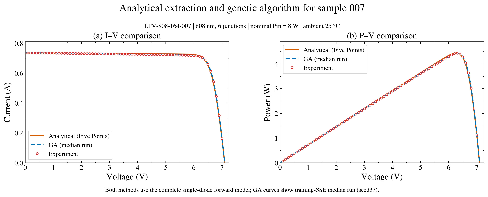
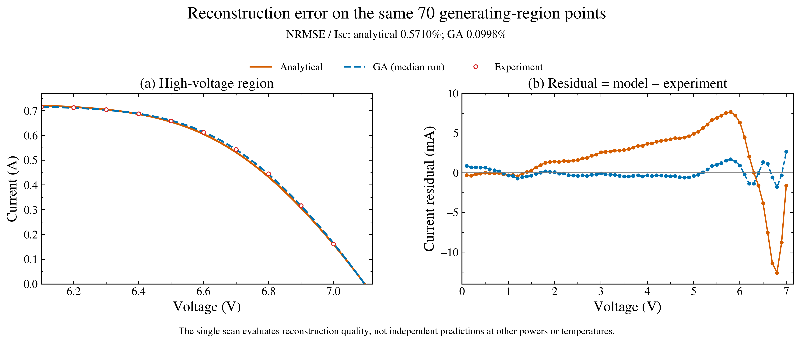
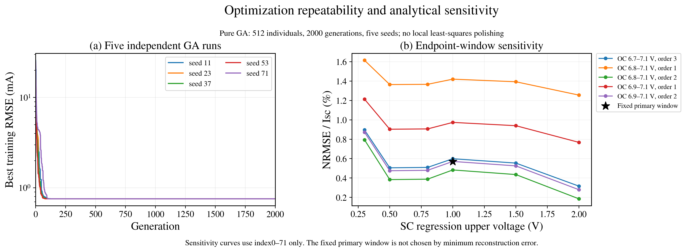

# 007号六结GaAs电池：解析提取与遗传算法比较

基于 `LPV-808-164-007` 实测 I–V 扫描，比较论文第2节的 Five Points 解析法和第5节遗传算法思路。两组参数均用于完整单二极管端口等效模型。

- [下载完整结果包](LPV808_007_Analytical_vs_GA.zip)：包含全部图、SVG、参数、逐点误差、007选定数据、五次GA记录及可复算Python代码。
- [详细方法、式（2）修正与误差说明](007_方法与误差比较说明.txt)
- [提取参数表](Extracted_Parameters.csv)
- [误差指标表](Error_Comparison.csv)

|70个发电区测试点的指标|Five Points解析法|遗传算法|
|---|---:|---:|
|电流RMSE / mA|4.1958|0.7335|
|NRMSE / %Isc|0.5710|0.0998|
|最大绝对电流误差 / mA|12.6006|2.6544|
|连续模型最大功率 / W|4.44124|4.43026|
|最大功率相对离散实测偏差 / %|+0.0552|−0.1923|

GA配置：512个体、2000代、5个独立种子；无局部最小二乘抛光。图表采用训练SSE排序居中的运行seed37。

## 曲线对比

[SVG矢量图](007_Analytical_GA_IV_PV.svg)

## 局部放大与残差

[SVG矢量图](007_Analytical_GA_Residuals.svg)

## 收敛与窗口敏感性

[SVG矢量图](007_GA_Convergence_Analytical_Sensitivity.svg)

## 方法范围

论文为肖文波等《太阳电池单二极管模型中的参数提取方法》，物理学报67，198801(2018)，[DOI:10.7498/aps.67.20181024](https://doi.org/10.7498/aps.67.20181024)。印刷式（2）的乘式存在量纲问题，本次显式采用商式修正，详见说明。

数据条件为808nm、6结、名义入射8W、面积1cm²、环境25°C；实际结温未测。GA使用前72点标定，主误差评价为相同70个严格发电点。结果反映同扫描重建，不能作为不同功率/温度的独立预测验证，也没有内部参数真值可计算参数误差。

完整包SHA256：`d6a2e93bd7d0cdbb5227a156a9eba31971c2d37369bfa4199b6db104ddf65d4d`。
