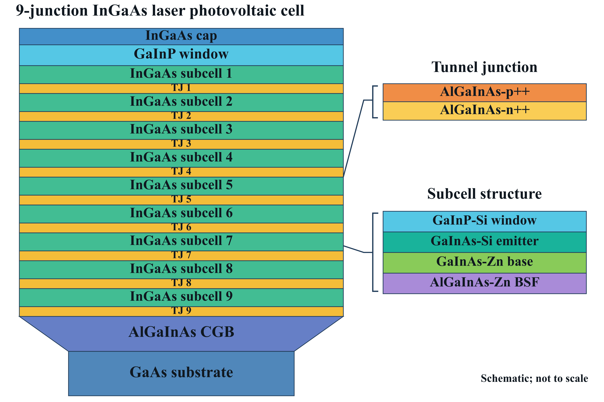

# 9结InGaAs激光光伏电池结构图：增强饱和度版

采用青绿子电池、金黄隧穿结、蓝色cap/衬底及橙紫材料详图；保留9个子电池、TJ1–TJ9和全部材料标注。矢量图/PNG/PPT采用同一场景与真实Times New Roman Bold字体，统一配色。示意图不按实际厚度比例。

- PNG：4608×3072，300dpi。
- SVG：真正矢量；字体转路径，打开不依赖本地字体；无嵌入位图。
- PDF：真正矢量，嵌入Times New Roman Bold字体；无位图。
- PPTX：文字、层块、梯形、引线均为原生可编辑对象，不是插入PNG。

[PNG](1064nm_9J_structure_saturated.png) · [SVG](1064nm_9J_structure_saturated.svg) · [PDF](1064nm_9J_structure_saturated.pdf) · [PPT](1064nm_9J_structure_saturated.pptx) · [全部格式ZIP](1064nm_9J_structure_all_formats.zip)

