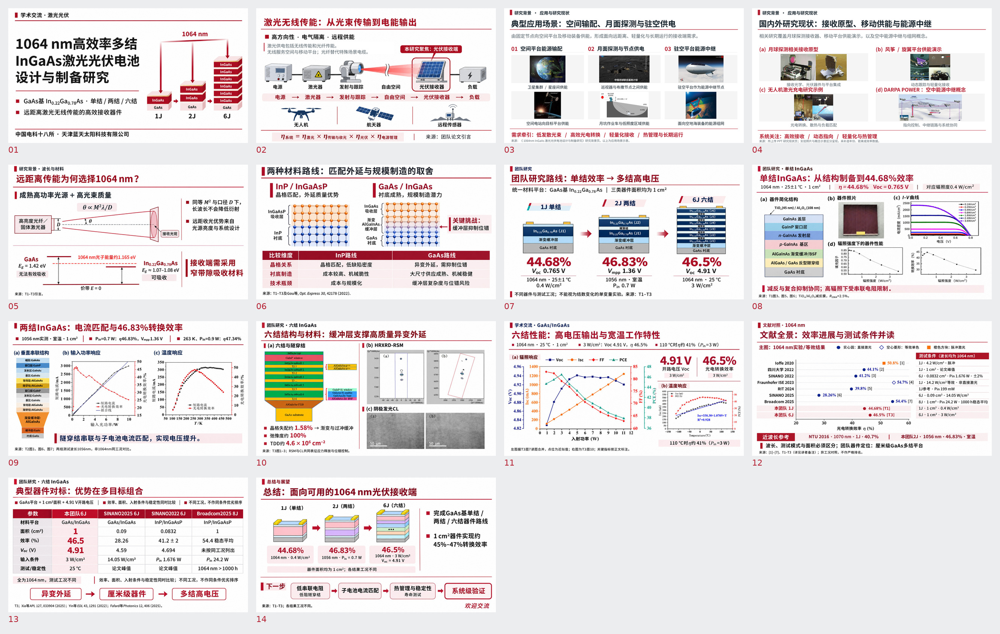

# 最初版补充背景与研究现状 · 红白图片版

以本次重新上传的 **1064nm_presentation.pptx（最初12页版）** 为底稿，补入《1064nm InGaAs激光光伏电池设计与制备研究》中的研究背景、典型应用场景和研究现状图文。最终14页，16:9、每页2880×1620，PPT约26.5 MB，单文件小于40 MB。

- [下载14页图片版PPT](https://github.com/ynyzzygm-cpu/ppt/raw/refs/heads/main/original_plus_background/1064nm_original_plus_background_redwhite.pptx)
- [下载PDF](https://github.com/ynyzzygm-cpu/ppt/raw/refs/heads/main/original_plus_background/1064nm_original_plus_background_redwhite.pdf)
- [下载14页高清PNG图片包](https://github.com/ynyzzygm-cpu/ppt/raw/refs/heads/main/original_plus_background/1064nm_original_plus_background_images.zip)
- [查看整稿预览](overview.jpg)
- [检查记录](validation.json)

## 本次修改

- 全部页面统一红白主配色，保留最初版的整体构图和视觉节奏。
- 原第2页补入无线传能与光纤传能的适用范围说明。
- 新第3页：典型应用场景，按空间输配、月面探测、驻空供电三类整理原PPT场景图及文字。
- 新第4页：国内外研究现状，呈现接收原型、风筝/旋翼平台供能演示、无人机充电研究示例和DARPA POWER能源中继概念。
- 最初版第3–12页顺延为第5–14页。最初版团队第5–9页对应新版第7–11页。

## 团队研究内容保留

单结、两结、六结的研究顺序、主要文字、数据、组图布局保持最初版。实验曲线、器件照片、RSM、CL及结构图中的12处关键区域以**原始PNG图片对象、原位置与原尺寸**嵌回中间工作稿，校验其原图哈希和几何位置，再统一渲染为最终图片版；未用新画曲线或生成式测量图替换这些内容。配色调整集中于标题、分隔、结果高亮和说明条。

原12页讲者备注完整保留，并为新增两页补充备注。实验曲线继续沿用最初版的原图/读图近似说明，关键指标仍以其原文标注为准。

## 画面与文件检查

- 原12页+新增2页，共14页，页序与映射已核对。
- 全部14页为整页高清图像PPT，每页只有一张2880×1620图片。
- 12处关键科学图块的来源哈希、原位置和尺寸通过校验。
- 原12页备注与底稿逐页比对一致，最终图片版保留全部备注。
- PPT可被实际Office引擎打开并渲染为14页，PDF文字无页面边界越界。
- 新增应用场景图与供图PPT中的原始媒体文件哈希一致；原研究照片按授权保留，未另造实验成果。

整理日期：2026-11-04。

