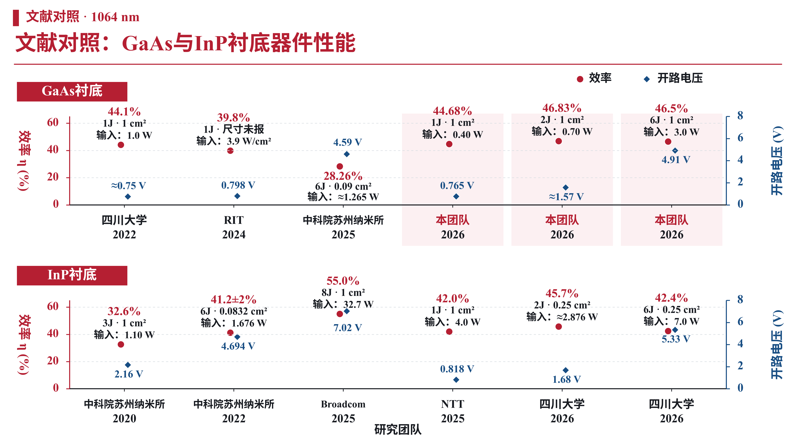

# 指定文献：效率与开路电压

最终筛选：GaAs为C18/C22/C25，并加本团队1J/2J/6J(C33/C31/C32)；InP为C13/C17/C24/C27/C29，其中C29的2J与优化6J分别列点。每幅6点，横轴只有团队和年份。

- `1064nm_selected_studies_slide.*`：修改后的单页PPT、PNG、SVG和PDF。
- `1064nm_GaAs_efficiency_Voc.*`：GaAs图的PNG、真正矢量SVG/PDF、可编辑PPT。
- `1064nm_InP_efficiency_Voc.*`：InP图的PNG、真正矢量SVG/PDF、可编辑PPT。
- `1064nm_both_figures_editable.pptx`：两幅图合并两页。
- `1064nm_three_slides_updated.pptx/pdf`：在上一版三页文件中仅更新第一页；第二三页画面和备注保留。

全部PNG为300dpi；SVG由字形路径、线和形状构成，无嵌入位图；PDF中的图为矢量。PPT的坐标轴、文字、圆点和菱形是原生可编辑对象，未使用整页截图，数据变更后须相应调整图形位置。英文与数字使用Times New Roman，中文使用Noto Sans CJK SC。

电压均按对应效率/功率配对。C18电压约0.75V、团队2J约1.57V为原图读数，注明≈；1.36V为Vmpp，不作Voc。C27的0.818V与C29优化6J的5.33V来自原图内嵌数据。RIT尺寸和配对总Pin不明确，保留原文输入光强3.9W/cm²，不用此前0.5W推算。按用户要求2J图面不额外标波长差异，原始测试信息仍在备注和source_notes.md中。

## 下载单页与整套

- [修改后的单页PPT](https://github.com/ynyzzygm-cpu/ppt/raw/refs/heads/main/selected_studies_voc/1064nm_selected_studies_slide.pptx)
- [更新后的三页PPT](https://github.com/ynyzzygm-cpu/ppt/raw/refs/heads/main/selected_studies_voc/1064nm_three_slides_updated.pptx)
- [全部格式ZIP](https://github.com/ynyzzygm-cpu/ppt/raw/refs/heads/main/selected_studies_voc/1064nm_comparison_all_formats.zip)

| 图像 | PNG | SVG矢量 | PDF矢量 | 可编辑PPT |
|---|---|---|---|---|
| GaAs | [PNG](1064nm_GaAs_efficiency_Voc.png) | [SVG](1064nm_GaAs_efficiency_Voc.svg) | [PDF](1064nm_GaAs_efficiency_Voc.pdf) | [PPT](1064nm_GaAs_efficiency_Voc.pptx) |
| InP | [PNG](1064nm_InP_efficiency_Voc.png) | [SVG](1064nm_InP_efficiency_Voc.svg) | [PDF](1064nm_InP_efficiency_Voc.pdf) | [PPT](1064nm_InP_efficiency_Voc.pptx) |

## 修改页预览

