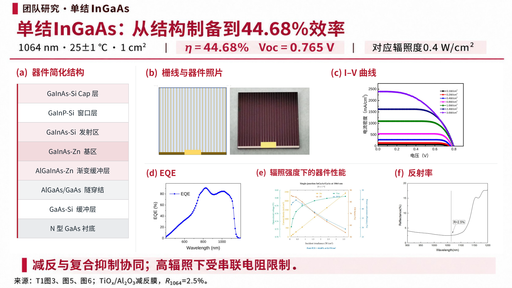

# 第8页单页修订

仅输出此页：1页、16:9、2880×1620，图片版PPT约2.2 MB。未重新生成或修改整套PPT。

- [下载单页PPT](https://github.com/ynyzzygm-cpu/ppt/raw/refs/heads/main/single_slide/page08_revised/1064nm_page08_revised.pptx)
- [查看PNG](1064nm_page08_revised.png)
- [下载单页PDF](https://github.com/ynyzzygm-cpu/ppt/raw/refs/heads/main/single_slide/page08_revised/1064nm_page08_revised.pdf)

结构图按用户最后一张截图左侧的单结层序书写，自上而下为：

1. GaInAs-Si Cap层
2. GaInP-Si 窗口层
3. GaInAs-Si 发射区
4. GaInAs-Zn 基区
5. AlGaInAs-Zn 渐变缓冲层
6. AlGaAs/GaAs 隧穿结
7. GaAs-Si 缓冲层
8. N型GaAs衬底

移除该页旧图，插入用户给出的5幅图对应的原始高清素材：栅线/器件照片、I–V、EQE、辐照响应、反射率。曲线未重画；两幅WMF矢量原图由原PPT转PDF后高分辨率提取，另外三幅直接使用原始PNG。

标题、测试条件/关键指标条、底部结论及来源段落沿用上一版原图内容，未重写。原第8页讲者备注保留。通过单页数、结构标签、图像哈希与Office打开渲染检查。

