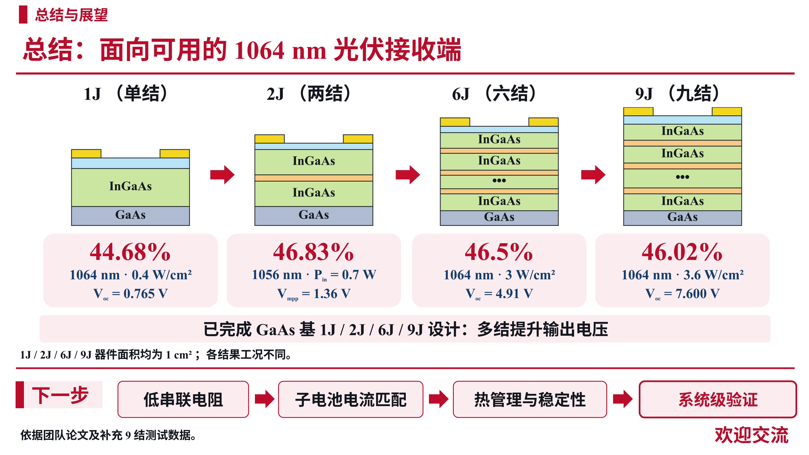

# 总结页：更新9结测试数据

- [下载图片版PPT](https://github.com/ynyzzygm-cpu/ppt/raw/refs/heads/main/summary_9j_update/1064nm_summary_9J_image.pptx)
- [下载可编辑版PPT](https://github.com/ynyzzygm-cpu/ppt/raw/refs/heads/main/summary_9j_update/1064nm_summary_9J_editable.pptx)
- [下载高清PNG](https://github.com/ynyzzygm-cpu/ppt/raw/refs/heads/main/summary_9j_update/1064nm_summary_9J.png)

9结更新为46.02%@1064 nm、3.6 W/cm²、Voc = 7.600 V。其余1J、2J、6J性能沿用原总结页。

图片版PPT为整页高清图片；可编辑版将四张结构图合为一张图片，其余标题、测试数据、条件、总结与展望文字均可编辑。英文及数字使用Times New Roman。

