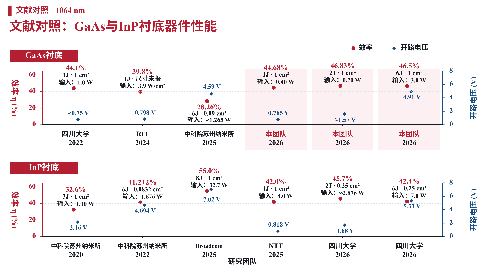
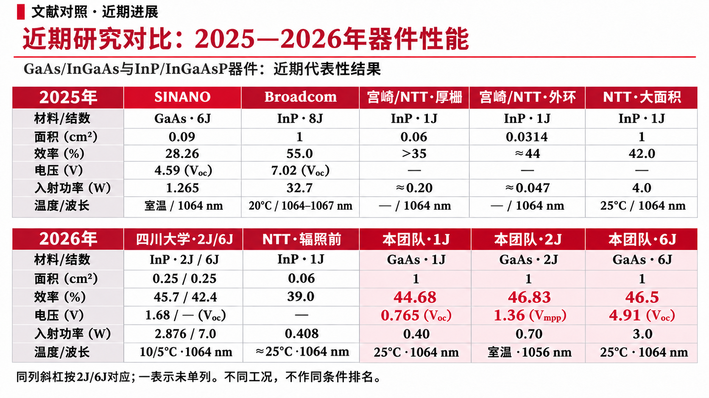
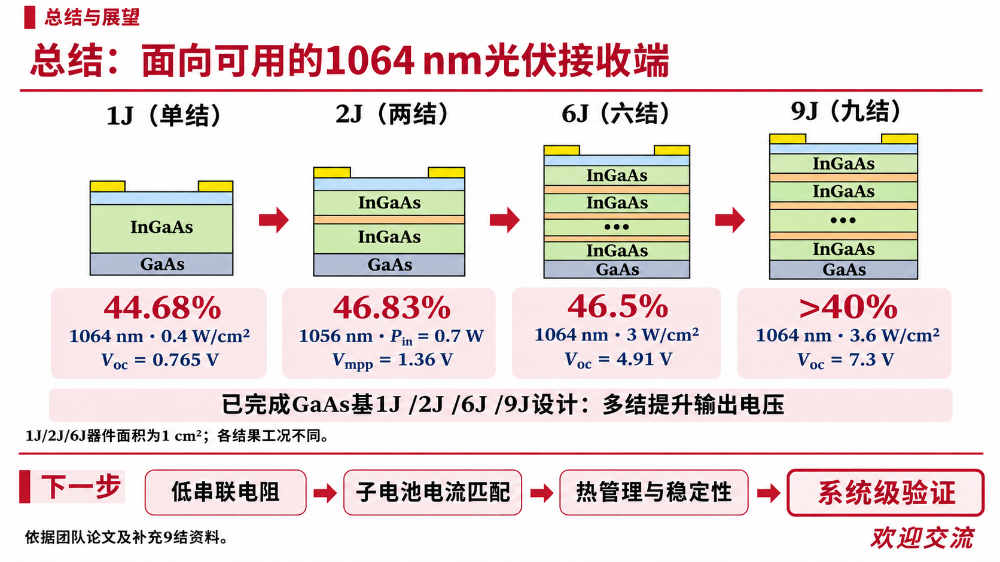

# 三页汇报文件（第一页已更新）

第一页按用户指定文献重新绘制：GaAs包括C18/C22/C25及本团队1J/2J/6J；InP包括C13/C17/C24/C27/C29，C29的2J与优化6J分别列点。左轴效率、右轴开路电压，效率点旁注明结数、面积与输入。横轴仅团队与年份；不额外标注2J波长差异。完整测试与来源保留在备注。

第二页2025—2026器件比较、第三页1/2/6/9J总结的图像和备注保留。第一页为原生可编辑对象；第二三页保持图片版。

- [下载更新后的三页PPT](https://github.com/ynyzzygm-cpu/ppt/raw/refs/heads/main/three_slide_update/1064nm_three_slides_updated.pptx)
- [PDF预览](https://github.com/ynyzzygm-cpu/ppt/raw/refs/heads/main/three_slide_update/1064nm_three_slides_updated.pdf)
- [PNG图片包](https://github.com/ynyzzygm-cpu/ppt/raw/refs/heads/main/three_slide_update/1064nm_three_slide_images.zip)
- [两幅图的PNG、真正矢量SVG/PDF及可编辑PPT](../selected_studies_voc/README.md)

